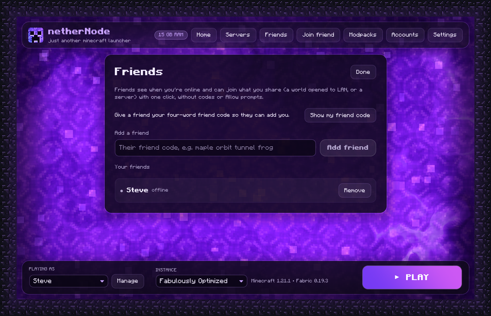
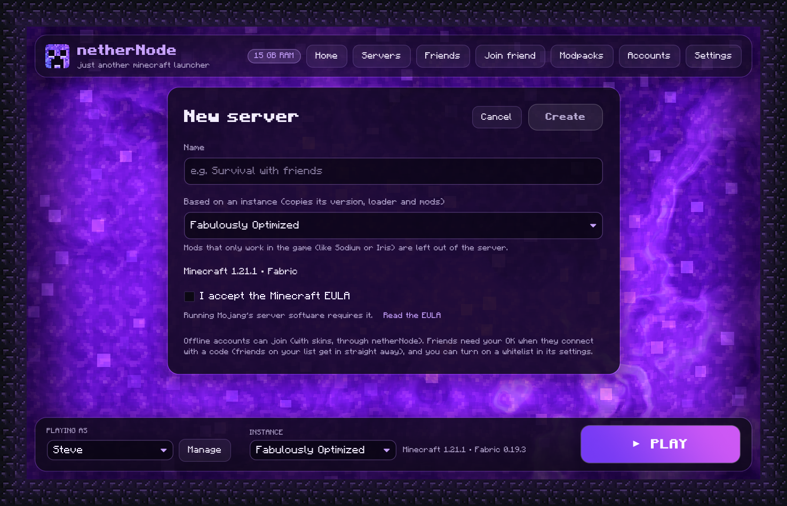

<p align="center">
  
</p>

<h1 align="center">netherNode</h1>

<p align="center">
  An offline Minecraft launcher for Windows, macOS and Linux: every version, every major mod loader, Modrinth mods and modpacks, your own servers, and playing with friends over the internet without port forwarding.
</p>

<p align="center">
  
</p>

## Features

**Play**
- **Offline accounts.** Play with any username. No Microsoft or Mojang login.
- **Every Minecraft version**, from old alphas to today's snapshot, straight from Mojang's list. The right Java is downloaded for you.
- **Fits your PC.** Game memory is sized to your RAM and to what's free right now. The game opens at 1280×720 or any size you choose, and low-RAM machines get lighter settings.
- **Helpful crash messages.** netherNode reads crash reports and Java errors and tells you the likely fix.
- **Custom skins and capes** for offline accounts (classic or slim arms). Friends who play with you through netherNode see them too, in worlds and on your servers.

**Mod**
- **Mod loaders in one click:** Fabric, Quilt, Forge (including pre-1.13) and NeoForge. Loaders that haven't released for a version yet are greyed out.
- **OptiFine, solved.** A one-click open-source alternative (Sodium, Iris shaders, connected textures, dynamic lights, zoom and more), or a real OptiFine jar.
- **Mods from Modrinth**, filtered to what works with the instance. Turn mods on and off, or drop `.jar` files onto the window.
- **No more "requires mod X, which is missing".** Before a modded game starts, netherNode reads what every mod needs and installs anything missing from Modrinth, including for jars you added yourself.
- **Modpacks** from Modrinth in one click, or import `.mrpack` files.
- **Big modpacks on Windows** start normally: long launch commands go through a file instead of hitting Windows' length limit.

**Together**
- **Play with friends over the internet.** Open your world to LAN, click *Invite friends*, and read out the four-word code (like `maple-orbit-tunnel-frog`). Your friend types it in *Join friend* and finds your world in Minecraft's LAN list. No port forwarding, works behind CGNAT, end-to-end encrypted, and you approve every new player.
- **Friends list.** Add friends once with a four-word friend code. You see who's online and what they're sharing, and join with one click: no codes, no Allow prompts.
- **Modded multiplayer that just works.** Join a friend who plays with mods and netherNode offers *Get the same mods*: the same loader and mods, from Modrinth or straight from your friend, every file checked.
- **Host servers on your PC:** Vanilla, Fabric, Forge, NeoForge (mods) or Paper (plugins). Run several at once, each with its own code. Make one from an instance to bring its mods along (game-only mods like Sodium are left out). Live console, every `server.properties` setting, a whitelist and skins. Your servers appear in Minecraft's Multiplayer list.
- **Voice chat and other mod ports.** Mods that need their own port, like Simple Voice Chat, work through the same tunnel; Simple Voice Chat is found automatically.
- **Desktop notifications** when someone wants in or your server is ready, so you notice even in fullscreen.

**Your stuff**
- **Bring your worlds:** import world folders or `.zip` backups into instances and servers.
- **Your folders:** keep game files, instances and servers on any drive (Settings).
- **Rename instances** any time (names stay unique).
- **A launcher that looks the part:** obsidian and violet glass over a live nether portal, in a Minecraft-style font. Block icons come from your own game files; netherNode never ships Mojang's art.

## Screenshots

| | |
|---|---|
|  |  |
| **New instance:** any version, any loader, OptiFine alternative | **Mods:** search and install from Modrinth |
|  |  |
| **Friends:** who's online and what they share | **Servers:** Vanilla, Fabric, Forge, NeoForge, Paper |
|  |  |
| **New server:** based on an instance, mods included | **Modpacks:** one click, or import `.mrpack` |
|  |  |
| **Instance settings:** name, loader, window size, worlds, memory | **Settings:** folders, graphics, skins |
|  |  |
| **Playing:** live game log, one-click stop | **Installed mods:** on/off, remove, drop jars in |
|  | |
| **Accounts:** offline names, custom skins and capes | |

## Download

Get the latest version from [**Releases**](../../releases).

| Platform | File |
|---|---|
| Windows 10/11 (x64, runs on ARM too) | `netherNode-…-windows-x64.zip` |
| macOS 11+ (Intel and Apple Silicon) | `netherNode-…-macos-universal.dmg` |
| Linux x64 | `netherNode-…-linux-x64.tar.gz` |

The builds aren't code-signed yet:

- **Windows:** if SmartScreen appears, click *More info*, then *Run anyway*.
- **macOS:** right-click the app, choose *Open*, then *Open* again. If macOS says it's damaged, run `xattr -dr com.apple.quarantine /Applications/netherNode.app`.
- **Linux:** run `./install.sh` to add netherNode to your app menu. Minecraft 1.12.2 and older also need the `xrandr` program.

## Getting started

1. Add an offline account: any name of 3–16 letters, digits or `_`.
2. Click **+ New instance**, pick a Minecraft version and, if you want mods, a loader.
3. Double-click the instance (or press **PLAY**). The first launch downloads the game and Java, which takes a few minutes.
4. For mods, open the instance's **Mods** screen. For ready-made packs, use **Modpacks** in the top bar.

## Playing with friends

**Your world, while you play**
1. Start your game and load a world. Press **Esc → Open to LAN → Start LAN World**.
2. In netherNode, click **Invite friends** on the instance and tell your friend the four words it shows (or **Copy code** and send it).
3. Your friend clicks **Join friend** and types the words. You click **Allow** (you also get a desktop notification). Friends on your list get in straight away.
4. Your friend opens **Multiplayer**: your world is in the LAN list. They can also Direct Connect to the `localhost` address netherNode shows them.

**A server, even when you're not playing**
1. **Servers → + New server**: pick Vanilla, Fabric, Forge, NeoForge or Paper and a Minecraft version, or choose **Based on an instance** to copy its version, loader and mods. Accept the Minecraft EULA.
2. **Start** it, then **Invite friends**: each server gets its own code, so several can run and be shared at once.
3. To play on it yourself, open Minecraft's **Multiplayer** list: it's there as "*name* (this PC)".

**Friends list**
1. **Friends → Show my friend code** gives you four words (valid for about an hour).
2. Your friend types them under **Add a friend**; you accept their request.
3. From then on you both see when the other is online and what they're sharing, with a **Join** button. No codes or Allow prompts between friends.

**Mods**

Both sides need the same Minecraft version and mods. When you join a modded world or server, netherNode shows **Get the same mods**: it makes a matching instance (mods from Modrinth, anything else from your friend), then **Play it** takes you straight in.

**Voice chat and other ports**

Simple Voice Chat's port is found automatically. For other mods that need a port, add it in the server's settings under *Extra ports* (for example `UDP 24454`).

**How it works:** netherNode uses [iroh](https://iroh.computer). Both computers connect outwards and punch a direct path through NAT when they can; otherwise traffic goes through a relay over HTTPS that only sees encrypted data. The four words unlock the full code (the host's id and a random secret) through iroh's public lookup service, new players need your OK, and only the Minecraft port and the ports you list are reachable. **Copy full code** gives the long form, which works without the lookup. Friends are recognised by a key each netherNode keeps in its data folder.

## Command line

The `nethernode` binary does everything the app does:

```sh
nethernode account add Steve
nethernode account skin Steve steve.png --slim     # a 64×64 skin PNG
nethernode instance create survival 1.21.1
nethernode instance create modded 1.21.1 --loader fabric --resolution 1920x1080
nethernode mods add modded sodium                 # plus required dependencies
nethernode mods check modded --fix                # install missing dependencies
nethernode mods optifine-alternative modded
nethernode modpack install fabulously-optimized
nethernode launch survival

nethernode server create smp 1.21.1 --kind paper --accept-eula
nethernode server create modded-smp --from-instance modded --accept-eula
nethernode server start smp --share               # prints a join code for friends
nethernode share host 51234 --udp 24454           # share a LAN world (and a voice chat port)
nethernode share join maple orbit tunnel frog --get-mods "Friend's pack"

nethernode friends run --code                     # stay online for friends, show your friend code
nethernode friends add ocean candle river fox     # add a friend by their code
```

Run `nethernode --help` for all commands.

## Where things are stored

| OS | Default folder |
|---|---|
| Windows | `%APPDATA%\nethernode\data` |
| macOS | `~/Library/Application Support/nethernode` |
| Linux | `~/.local/share/nethernode` |

Game files, instances and servers can each be moved in **Settings**. Game files, libraries and Java are shared between instances, and each instance has its own `.minecraft` folder for worlds, mods and settings. Set `NETHERNODE_HOME` to use a completely separate folder (a portable install).

## Building from source

Requires [Rust](https://rustup.rs) (stable).

```sh
cargo build --release
target/release/nethernode-gui     # the app
target/release/nethernode         # the CLI
```

The workspace has three crates:

- `crates/core`: the launcher library (versions, downloads, Java, loaders, mods and their dependencies, modpacks, servers, skins, sharing, friends, crash analysis)
- `crates/cli`: the `nethernode` command
- `crates/gui`: the `nethernode-gui` app, built with [iced](https://iced.rs)

Pushing a `v*` tag builds Windows, macOS and Linux releases through GitHub Actions.

## FAQ

**Can I join online-mode servers?** No. Offline accounts work in singleplayer, LAN, servers in offline mode, netherNode's own servers, and friends' worlds through *Join friend*.

**Can friends who don't use netherNode join me?** Your server, yes, if they can reach it (on your LAN, or with your own port forwarding) and you turn off *Show players' skins* in its settings. Playing over the internet without port forwarding needs netherNode on both sides.

**Is a server for offline accounts safe?** It can't check that a name belongs to someone, so anyone who gets in could pick any name. netherNode only lets in people you approve (and your friends), and you can turn on a whitelist in the server's settings.

**A mod says another mod is missing.** netherNode installs missing dependencies from Modrinth before the game starts. If one isn't on Modrinth for your version, the crash message says so: get it from the mod's own page and drop the jar on the Mods screen.

**A mod needs another port (voice chat).** Simple Voice Chat is found automatically. For other mods, add the port in the server's settings under *Extra ports* (for example `UDP 24454`). Friends get it through the same tunnel.

**My friend joined but can't connect: "Incompatible mods" or a mod mismatch.** Both of you need the same mods. Click **Get the same mods** in the banner after joining, then **Play it**.

**What about OptiFine?** Pick *OptiFine* when creating an instance. The default, *One-click alternative*, installs open-source mods that do what OptiFine does: Sodium, Iris (OptiFine shader packs work), Continuity, Entity Texture/Model Features, dynamic lights, zoom and more. OptiFine itself can't be downloaded by other apps (its author doesn't allow it), so the real thing needs a jar from optifine.net, which netherNode then installs for you.

**How do skins work without a login?** netherNode runs a small skin service on your own computer and starts the game (and your servers) with [authlib-injector](https://github.com/yushijinhun/authlib-injector), which sends the game's skin lookups there instead of to Mojang. authlib-injector is open source (AGPL-3.0); netherNode downloads it once from its official site and checks its checksum. Turn skins off in **Settings** if you prefer.

**My friend sees me with a default skin.** You both need netherNode 1.2 or newer with skins on (Settings), and your friend has to join through *Join friend* or your friends list, which is how your skin reaches them. On servers, check *Show players' skins* in the server's settings.

**Join friend says no one is sharing with that code.** Check the four words with your friend; spaces or dashes both work, and the first four letters of each word are enough. The words only work while your friend is sharing; a new session gives new words. If the lookup service can't be reached, ask your friend for **Copy full code** and paste that instead.

**My friend shows as offline.** Friends show online while netherNode is open on their computer and it can reach the internet. It can take up to half a minute to update.

**My computer has little RAM. Will it run?** Yes. netherNode sizes the game's memory to what your computer has and what's free, gives low-RAM machines lighter game settings, and uses a lighter launcher renderer at 4 GB or less. Close other programs before a big modpack, and see the crash message if the game runs out of memory.

**The game crashed. What now?** netherNode shows the likely cause and a fix on the instance. The full log is under the instance's **Folder** (`logs/latest.log`, and `crash-reports/`).

**Does netherNode collect any data?** No. It talks to Mojang (game files and Java), Modrinth (mods and modpacks), the mod loader and Paper sites (when you install those), authlib-injector's site (once, for skins) and iroh's relay and lookup services (for playing with friends and your friends list). There are no accounts, analytics or telemetry.

## Credits

The interface uses the public-domain [Minecraft font](https://www.fontspace.com/minecraft-font-f28180) with [Inter](https://rsms.me/inter/) and [JetBrains Mono](https://www.jetbrains.com/lp/mono/) (SIL Open Font License); see `assets/fonts/`. Networking for *Invite friends* is built on [iroh](https://iroh.computer). Short codes use the [BIP-39](https://github.com/bitcoin/bips/blob/master/bip-0039/english.txt) English word list. In-game skins use [authlib-injector](https://github.com/yushijinhun/authlib-injector), downloaded at runtime.

## License

netherNode is free software under the [GNU General Public License v3.0](LICENSE) (or any later version). You can use, study, share and change it; if you distribute a changed version, it has to be under the GPL too, with its source code. Bundled fonts keep their own licenses (see `assets/fonts/`). Minecraft is a trademark of Mojang AB; netherNode is not affiliated with Mojang or Microsoft.

## Roadmap

See [ROADMAP.md](ROADMAP.md) for what's done and what's next.
