<p align="center">
  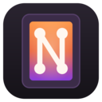
</p>

<h1 align="center">netherNode</h1>

<p align="center">
  An offline Minecraft launcher for Windows, macOS and Linux: every version, every major mod loader, Modrinth mods and modpacks, your own servers, and playing with friends over the internet without port forwarding.
</p>

<p align="center">
  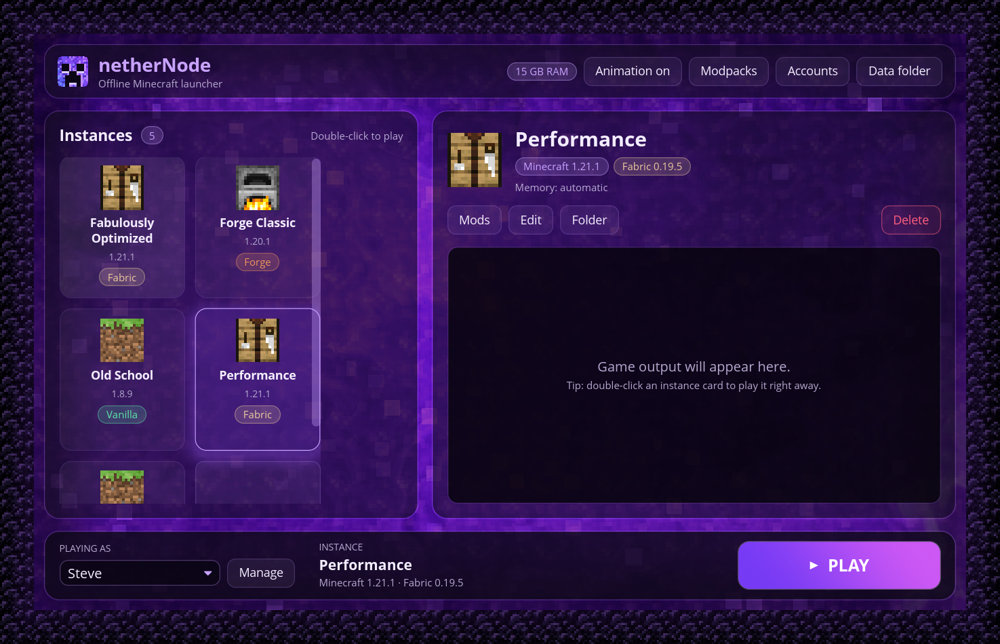
</p>

## Features

**Play**
- **Offline accounts.** Play with any username. No Microsoft or Mojang login.
- **Every Minecraft version**, from old alphas to today's snapshot, straight from Mojang's list. The right Java is downloaded for you.
- **Fits your PC.** Game memory is sized to your RAM and to what's free right now. The game opens at 1280×720 or any size you choose, and low-RAM machines get lighter settings.
- **Helpful crash messages.** netherNode reads crash reports and Java errors and tells you the likely fix.
- **Custom skins and capes** for offline accounts, chosen under **Accounts** (classic or slim arms). Friends who join you with netherNode get your skin too.

**Mod**
- **Mod loaders in one click:** Fabric, Quilt, Forge (including pre-1.13) and NeoForge. Loaders that haven't released for a version yet are greyed out.
- **OptiFine, solved.** A one-click open-source alternative (Sodium, Iris shaders, connected textures, dynamic lights, zoom and more), or a real OptiFine jar.
- **Mods from Modrinth**, filtered to what works with the instance, with dependencies installed automatically. Turn mods on and off, or drop `.jar` files onto the window.
- **Modpacks** from Modrinth in one click, or import `.mrpack` files.

**Together**
- **Play with friends over the internet.** Open your world to LAN, click *Invite friends*, and read out the four-word code (like `maple-orbit-tunnel-frog`). Your friend clicks *Join friend*, types it, and finds your world in Minecraft's LAN list. No port forwarding, works behind CGNAT, end-to-end encrypted, and you approve every friend.
- **Friends list.** Add friends once with a four-word friend code. You see who's online and what they're sharing, and join with one click: no codes, no Allow prompts.
- **Modded multiplayer that just works.** When you join a friend who plays with mods, netherNode offers *Get the same mods*: the same loader and mods, from Modrinth or straight from your friend.
- **Host servers on your PC:** Vanilla, Fabric, Forge, NeoForge (mods) or Paper (plugins), several at once, each with its own code. Make one from an instance to bring its mods along. Live console, every `server.properties` setting, a whitelist, and skins. Your servers appear in Minecraft's Multiplayer list.
- **Voice chat and other mod ports** (like Simple Voice Chat's UDP port) travel through the same tunnel.
- **Desktop notifications** when a friend wants in or your server is ready, so you notice even in fullscreen.

**Your stuff**
- **Bring your worlds:** import world folders or `.zip` backups into instances and servers.
- **Your folders:** keep game files, instances and servers on any drive (Settings).
- **A launcher that looks the part:** obsidian and violet glass over a live nether portal that pauses while you play. Textures come from your own game files; netherNode never ships Mojang's.

## Screenshots

| | |
|---|---|
| 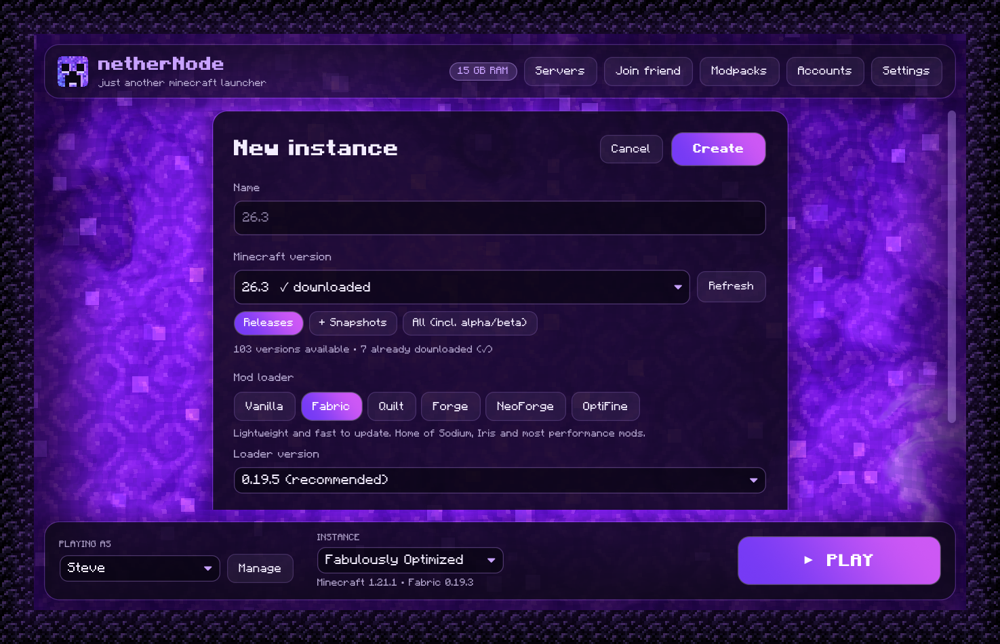 | 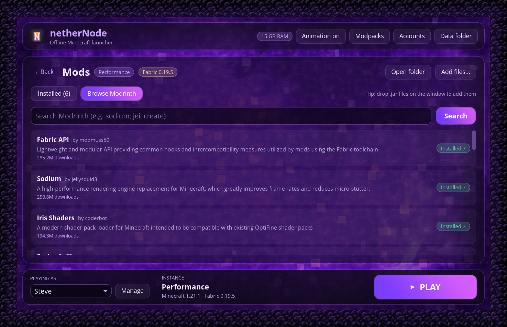 |
| **New instance:** any version, any loader, OptiFine alternative | **Mods:** search and install from Modrinth |
| 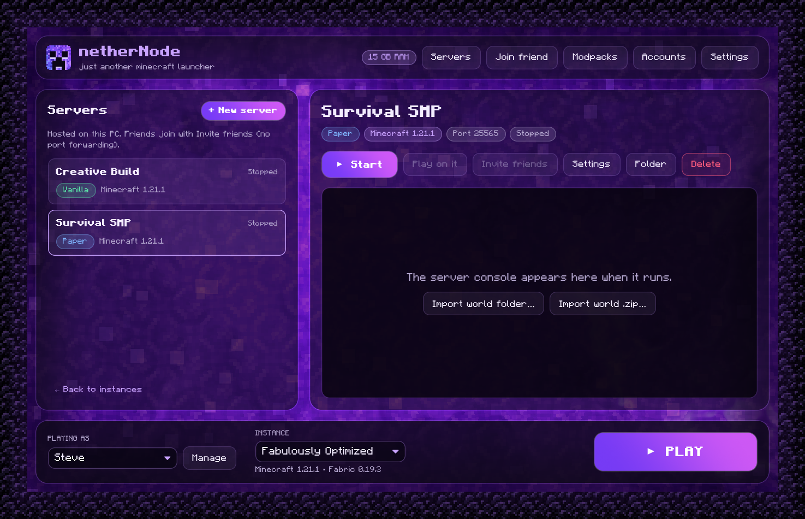 | 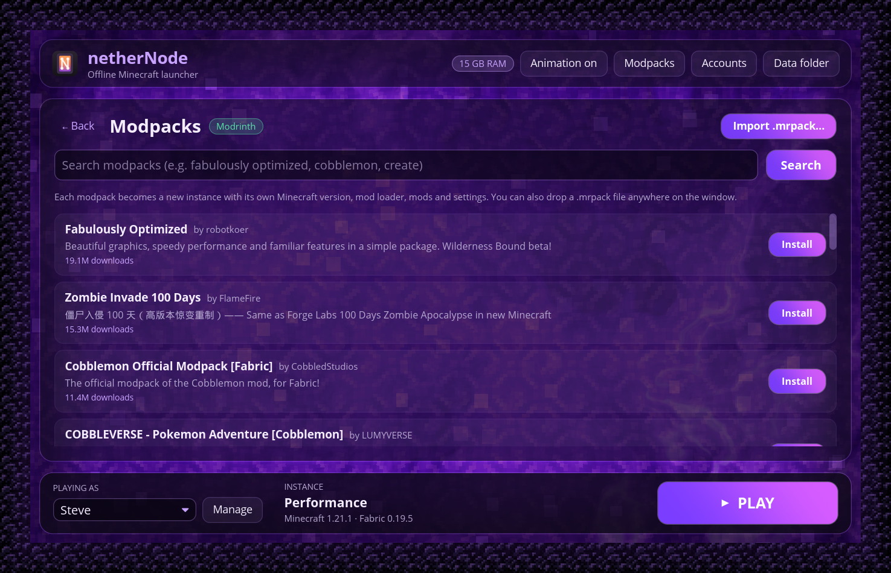 |
| **Servers:** host on your PC and share with friends | **Modpacks:** one click, or import `.mrpack` |
| 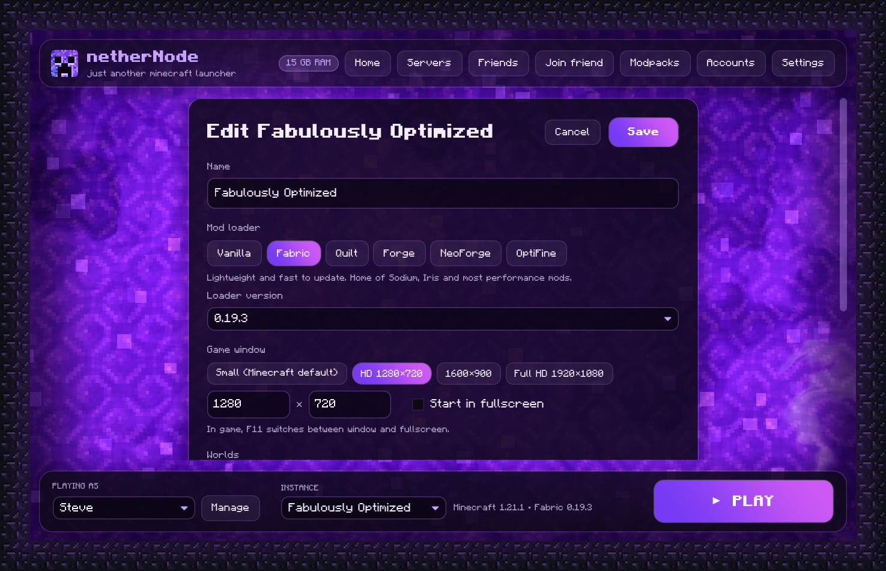 | 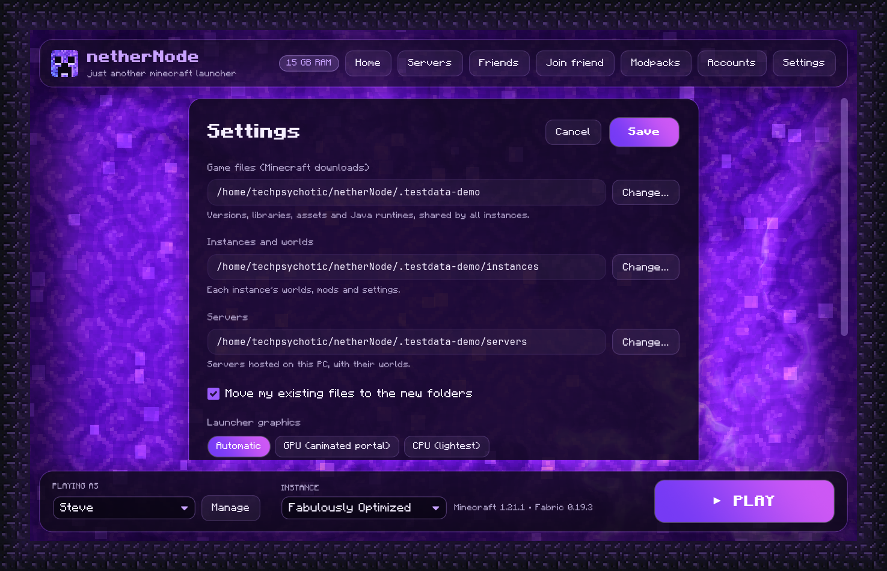 |
| **Instance settings:** loader, window size, worlds, memory | **Settings:** folders, graphics |
| 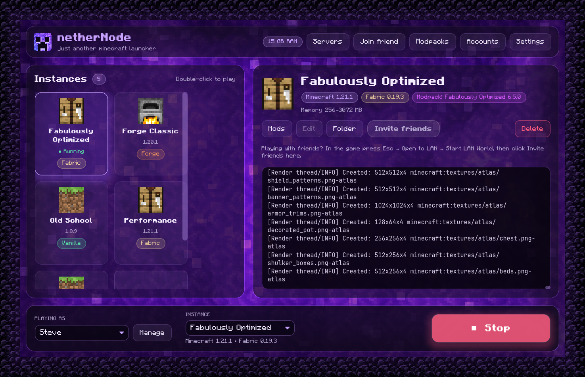 | 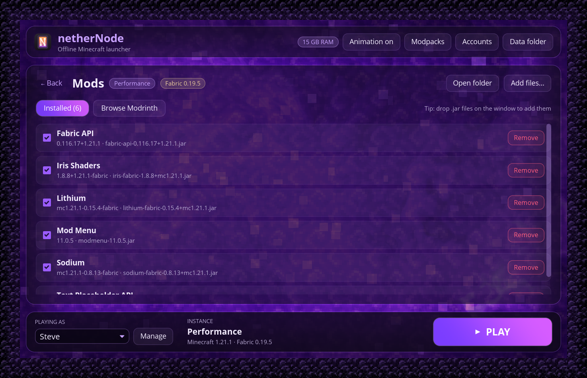 |
| **Playing:** live game log, one-click stop | **Installed mods:** on/off, remove, drop jars in |
| 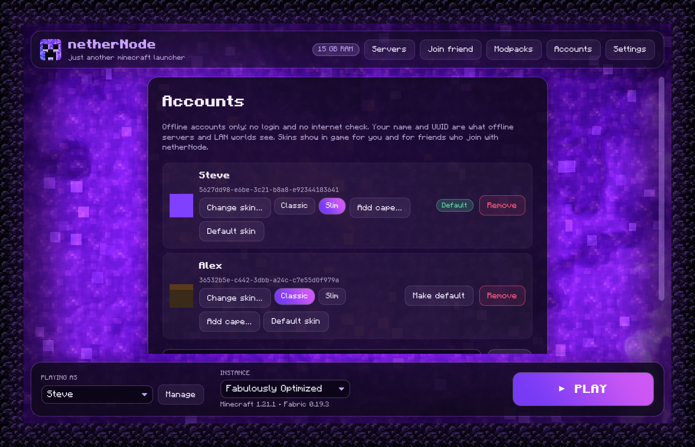 | |
| **Accounts:** offline names, custom skins and capes | |

## Download

Get the latest version from [**Releases**](../../releases).

| Platform | File |
|---|---|
| Windows 10/11 (x64, runs on ARM too) | `netherNode-…-windows-x64.zip` |
| macOS 11+ (Intel and Apple Silicon) | `netherNode-…-macos-universal.dmg` |
| Linux x64 | `netherNode-…-linux-x64.tar.gz` |

The builds aren't code-signed yet:

- **Windows:** if SmartScreen appears, click *More info*, then *Run anyway*.
- **macOS:** right-click the app, choose *Open*, then *Open* again. If macOS says it's damaged, run `xattr -dr com.apple.quarantine /Applications/netherNode.app`.
- **Linux:** run `./install.sh` to add netherNode to your app menu. Minecraft 1.12.2 and older also need the `xrandr` program.

## Getting started

1. Add an offline account: any name of 3–16 letters, digits or `_`.
2. Click **+ New instance**, pick a Minecraft version and, if you want mods, a loader.
3. Double-click the instance (or press **PLAY**). The first launch downloads the game and Java, which takes a few minutes.
4. For mods, open the instance's **Mods** screen. For ready-made packs, use **Modpacks** in the top bar.

## Playing with friends

**Your world, while you play**
1. Start your game and load a world. Press **Esc → Open to LAN → Start LAN World**.
2. In netherNode, click **Invite friends** (on the instance) and tell your friend the four words it shows, or **Copy code** and send it.
3. Your friend clicks **Join friend**, types the words, and you click **Allow** when asked. You also get a desktop notification.
4. Your friend opens **Multiplayer**; your world is in the LAN list. They can also Direct Connect to the `localhost` address netherNode shows them.

**A server, even when you're not playing**
1. **Servers → + New server**: name, Minecraft version, Vanilla / Fabric / Forge / NeoForge / Paper, or *Based on an instance* to copy its version, loader and mods. Accept the Minecraft EULA.
2. **Start** it. When it's ready, **Invite friends** works just like above. To play on it yourself, open Minecraft's **Multiplayer** list: it's there as "*name* (this PC)".

**Friends list:** **Friends → Show my friend code**, and your friend types it under **Add a friend**. Once they accept, each of you sees when the other is online and what they're sharing, with a **Join** button.

**Mods:** both sides need the same Minecraft version and mods. When you join a modded world or server, click **Get the same mods** and netherNode makes a matching instance, then **Play it**.

**How it works:** netherNode uses [iroh](https://iroh.computer). Both computers connect outwards and punch a direct path through NAT when they can; otherwise traffic goes through a relay over HTTPS that only sees encrypted data. The four words unlock the full code (the host's id and a random secret) through iroh's public lookup service, you approve each friend, and only the Minecraft port is reachable. **Copy full code** gives the long form, which works without the lookup.

## Command line

The `nethernode` binary does everything the app does:

```sh
nethernode account add Steve
nethernode account skin Steve steve.png --slim     # a 64×64 skin PNG
nethernode instance create survival 1.21.1
nethernode instance create modded 1.21.1 --loader fabric --resolution 1920x1080
nethernode mods add modded sodium                 # plus required dependencies
nethernode mods optifine-alternative modded
nethernode modpack install fabulously-optimized
nethernode launch survival

nethernode server create smp 1.21.1 --kind paper --accept-eula
nethernode server start smp --share               # prints a join code for friends
nethernode share join maple orbit tunnel frog      # join a friend's world or server
```

Run `nethernode --help` for all commands.

## Where things are stored

| OS | Default folder |
|---|---|
| Windows | `%APPDATA%\nethernode\data` |
| macOS | `~/Library/Application Support/nethernode` |
| Linux | `~/.local/share/nethernode` |

Game files, instances and servers can each be moved in **Settings**. Game files, libraries and Java are shared between instances, and each instance has its own `.minecraft` folder for worlds, mods and settings. Set `NETHERNODE_HOME` to use a completely separate folder (a portable install).

## Building from source

Requires [Rust](https://rustup.rs) (stable).

```sh
cargo build --release
target/release/nethernode-gui     # the app
target/release/nethernode         # the CLI
```

The workspace has three crates:

- `crates/core`: the launcher library (versions, downloads, Java, loaders, mods, modpacks, servers, sharing, crash analysis)
- `crates/cli`: the `nethernode` command
- `crates/gui`: the `nethernode-gui` app, built with [iced](https://iced.rs)

Pushing a `v*` tag builds Windows, macOS and Linux releases through GitHub Actions.

## FAQ

**A mod needs another port (voice chat).** netherNode finds Simple Voice Chat's port by itself. For other mods, add the port in the server's settings (*Extra ports*, e.g. `UDP 24454`). Friends get it through the same tunnel.

**Can I join online-mode servers?** No. Offline accounts work in singleplayer, LAN, servers in offline mode (like the ones netherNode hosts), and friends' worlds through *Join friend*.

**Is a server in offline mode safe?** It can't check names, so anyone who gets in could use any name. netherNode only lets in friends you approve, and you can turn on a whitelist in the server's settings.

**What about OptiFine?** Pick *OptiFine* when creating an instance. The default, *One-click alternative*, installs open-source mods that do what OptiFine does: Sodium, Iris (OptiFine shader packs work), Continuity, Entity Texture/Model Features, dynamic lights, zoom and more. OptiFine itself can't be downloaded by other apps (its author doesn't allow it), so the real thing needs a jar from optifine.net, which netherNode then installs for you.

**How do skins work without a login?** netherNode runs a small skin service on your own computer and starts the game with [authlib-injector](https://github.com/yushijinhun/authlib-injector), which sends the game's skin lookups there instead of to Mojang. authlib-injector is open source (AGPL-3.0); netherNode downloads it once from its official site and checks its checksum. Turn skins off in **Settings** if you prefer.

**My friend sees me with a default skin.** Both of you need netherNode 1.2 or newer with skins on (Settings), and your friend has to join through *Join friend* or your friends list, which is how your skin reaches them. On servers hosted in netherNode, skins are on by default (server settings → *Show players' skins*).

**Join friend says no one is sharing with that code.** Check the four words with your friend; spaces or dashes between them both work, and the first four letters of each word are enough. The words only work while your friend is sharing; a new session gives new words. If the lookup service can't be reached, ask your friend for **Copy full code** and paste that instead.

**Can friends who don't use netherNode join me?** Your server, yes, if they can reach it (on your LAN, or with your own port forwarding) and you turn off *Show players' skins* in its settings. *Invite friends* over the internet needs netherNode on both sides.

**My computer has little RAM. Will it run?** Yes. netherNode sizes the game's memory to what your computer has and what's free, gives low-RAM machines lighter game settings, and uses a lighter launcher renderer at 4 GB or less. Close other programs before a big modpack, and see the crash message if the game runs out of memory.

**The game crashed. What now?** netherNode shows the likely cause and a fix on the instance. The full log is under the instance's **Folder** (`logs/latest.log`, and `crash-reports/`).

**Does netherNode collect any data?** No. It talks to Mojang (game files and Java), Modrinth (mods and modpacks), the mod loader and Paper sites (when you install those), authlib-injector's site (once, for skins) and iroh's relay and lookup services (only for *Invite friends* / *Join friend*). There are no accounts, analytics or telemetry.

## Credits

The interface uses the public-domain [Minecraft font](https://www.fontspace.com/minecraft-font-f28180) with [Inter](https://rsms.me/inter/) and [JetBrains Mono](https://www.jetbrains.com/lp/mono/) (SIL Open Font License); see `assets/fonts/`. Networking for *Invite friends* is built on [iroh](https://iroh.computer). Short codes use the [BIP-39](https://github.com/bitcoin/bips/blob/master/bip-0039/english.txt) English word list. In-game skins use [authlib-injector](https://github.com/yushijinhun/authlib-injector), downloaded at runtime.

## License

netherNode is free software under the [GNU General Public License v3.0](LICENSE) (or any later version). You can use, study, share and change it; if you distribute a changed version, it has to be under the GPL too, with its source code. Bundled fonts keep their own licenses (see `assets/fonts/`). Minecraft is a trademark of Mojang AB; netherNode is not affiliated with Mojang or Microsoft.

## Roadmap

See [ROADMAP.md](ROADMAP.md) for what's done and what's next.
